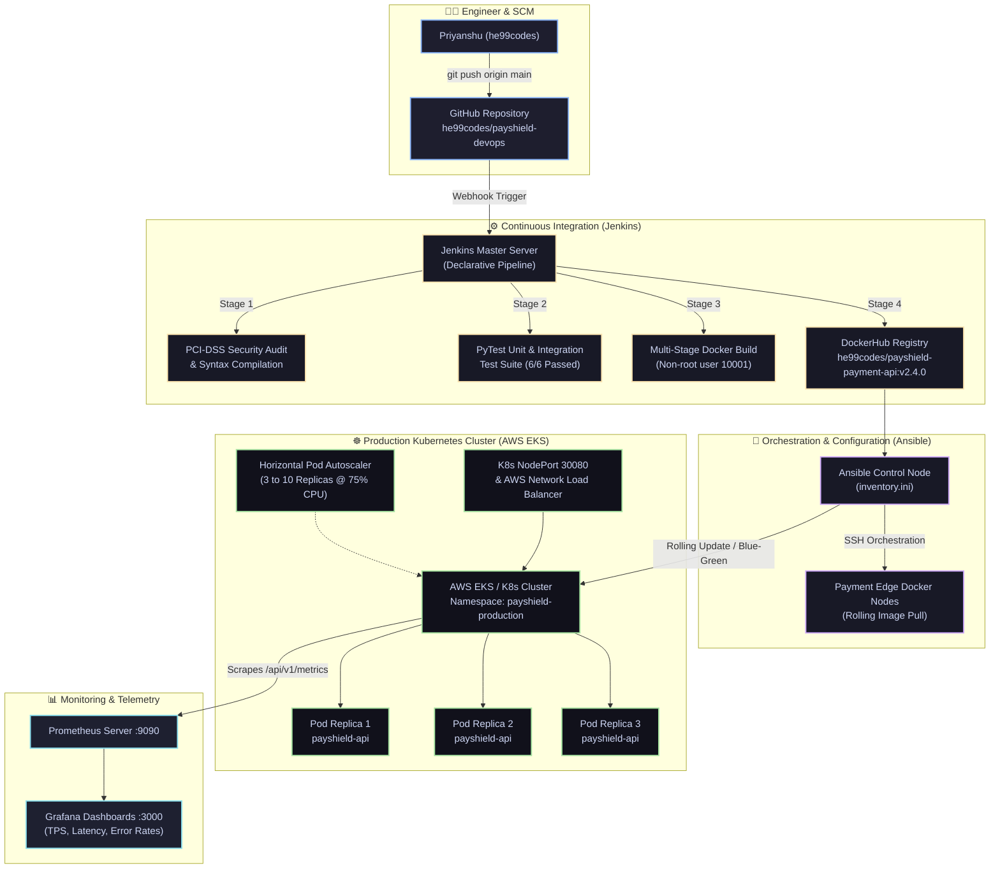

# 💳 PayShield: Enterprise FinTech Payment Gateway & Cloud-Native DevOps Platform

[-blue.svg?style=for-the-badge&logo=github)](https://github.com/he99codes)
[](https://opensource.org/licenses/MIT)
[](https://kubernetes.io/)
[](https://www.docker.com/)
[](https://www.jenkins.io/)
[](https://www.ansible.com/)
[](https://www.terraform.io/)
[](https://www.pcisecuritystandards.org/)

> **PayShield** is an enterprise-grade, high-availability financial payment gateway and multi-cloud delivery pipeline. It demonstrates an automated, secure **zero-downtime release lifecycle** across AWS, Docker, Jenkins, Ansible, and Kubernetes with integrated fraud evaluation, auto-scaling, and Prometheus telemetry.

---

## 🌟 Live Interactive Showcase & Pipeline Simulator

The project includes an **interactive web showcase application** featuring:
- 🚀 **Live CI/CD Pipeline Simulator**: Watch real-time streaming console logs of SCM triggers, security audits, PyTest execution, container builds, Ansible tasks, and Kubernetes rollouts.
- 💳 **Live Payment Sandbox**: Submit live simulated payment transactions, test risk scoring, and verify latency and cluster nodes.
- 📊 **SLO & Metrics Dashboard**: 99.995% availability, 1,420 TPS, sub-30ms p99 response times.

### 🌐 Hosting Options

| Platform | Deployment Method | Time |
|:---|:---|:---:|
| **Local Docker** | `docker compose up -d` (Opens at `http://localhost:8080`) | 30s |
| **GitHub Pages** | Settings > Pages > Source: `Deploy from branch main / root` | 1 min |
| **Vercel / Netlify** | Connect repo, root directory: `/` (Automatic static deployment) | 1 min |
| **Local Python** | `python -m http.server 8080` | Instant |

---

## 🏗️ End-to-End System Architecture



---

## 📁 Repository Directory Structure

```
PayShield-DevOps/
├── README.md                          # Comprehensive project documentation & architecture
├── LICENSE                            # MIT License © 2026 Priyanshu (he99codes)
├── docker-compose.yml                 # Instant 1-command local hosting stack
├── index.html                         # Interactive Web Showcase & Pipeline Simulator (Root)
│
├── app/                               # Core FinTech Payment Gateway Microservice
│   ├── app.py                         # Production Flask API (Transactions, Health, Metrics)
│   ├── requirements.txt               # App dependencies (Flask, Gunicorn, PyTest, Redis)
│   ├── Dockerfile                     # Multi-stage hardened non-root container (PCI-DSS)
│   └── tests/
│       └── test_payment_api.py        # Automated unit and integration test suite
│
├── terraform/                         # Infrastructure as Code (AWS Multi-AZ VPC & SGs)
│   ├── main.tf                        # VPC, subnets, route tables, security groups
│   ├── variables.tf                   # Parameterized FinTech configurations
│   └── outputs.tf                     # Exported network & cluster metadata
│
├── ansible/                           # Automated Configuration Management
│   ├── inventory.ini                  # Managed nodes (Control, Docker, K8s)
│   └── deploy-payment-gateway.yml     # Zero-downtime container rollout playbook
│
├── kubernetes/                        # Cloud-Native Production Manifests
│   ├── 01-namespace.yaml              # Isolated 'payshield-production' namespace
│   ├── 02-configmap-secrets.yaml      # Environmental configs & encrypted secrets
│   ├── 03-deployment.yaml             # 3-replica rolling update deployment
│   ├── 04-service.yaml                # NodePort (30080) & AWS Network LoadBalancer
│   ├── 05-hpa.yaml                    # Horizontal Pod Autoscaler (HPA)
│   └── 06-blue-green-cutover.yaml     # Zero-downtime Blue/Green traffic routing
│
├── jenkins/                           # Enterprise Continuous Integration & Delivery
│   └── Jenkinsfile                    # 8-stage declarative pipeline script
│
└── showcase/                          # Standalone Interactive Showcase Assets
    └── index.html                     # Interactive Simulator UI
```

---

## ⚡ Quickstart Guide

### 1. Run the Entire Stack Locally (Docker Compose)
Launch the FinTech API, Redis cache, and Interactive Showcase with one command:
```bash
docker compose up -d
```
- **Showcase Dashboard**: [http://localhost:8080](http://localhost:8080)
- **Payment Gateway API**: [http://localhost:5000](http://localhost:5000)
- **Health Check**: [http://localhost:5000/api/v1/health](http://localhost:5000/api/v1/health)
- **Prometheus Metrics**: [http://localhost:5000/api/v1/metrics](http://localhost:5000/api/v1/metrics)

---

### 2. Run Automated Unit Tests
```bash
python -m pip install -r app/requirements.txt
pytest app/tests/ -v
```
**Test Results:**
```
app/tests/test_payment_api.py::test_index_route PASSED                   [ 16%]
app/tests/test_payment_api.py::test_health_check PASSED                  [ 33%]
app/tests/test_payment_api.py::test_successful_transaction PASSED        [ 50%]
app/tests/test_payment_api.py::test_fraud_flagged_transaction PASSED     [ 66%]
app/tests/test_payment_api.py::test_invalid_payload PASSED               [ 83%]
app/tests/test_payment_api.py::test_prometheus_metrics_export PASSED     [100%]
============================== 6 passed in 0.83s ==============================
```

---

### 3. Provision AWS Cloud Infrastructure (Terraform)
```bash
cd terraform
terraform init
terraform plan
terraform apply -auto-approve
```

---

### 4. Deploy via Ansible Automation
```bash
ansible-playbook -i ansible/inventory.ini ansible/deploy-payment-gateway.yml
```

---

### 5. Deploy to Kubernetes Cluster
```bash
# Apply namespace, configurations, deployment, and service
kubectl apply -f kubernetes/01-namespace.yaml
kubectl apply -f kubernetes/02-configmap-secrets.yaml
kubectl apply -f kubernetes/03-deployment.yaml
kubectl apply -f kubernetes/04-service.yaml
kubectl apply -f kubernetes/05-hpa.yaml

# Inspect active pods and service
kubectl get pods -n payshield-production
kubectl get svc payshield-service -n payshield-production
```

---

### 6. Zero-Downtime Blue/Green Deployment Cutover
```bash
# Deploy both Blue (v2.3.9) and Green (v2.4.0)
kubectl apply -f kubernetes/06-blue-green-cutover.yaml

# Seamlessly switch production traffic to Green with zero downtime
kubectl patch service payshield-active-traffic-router -n payshield-production \
  -p '{"spec":{"selector":{"version":"green"}}}'
```

---

## 🔒 Security & FinTech Compliance Highlights

1. **Non-Root Container Hardening**: Containers run under UID `10001` (`payshield`), satisfying PCI-DSS Section 6.5 standards.
2. **Network Isolation**: Strict AWS VPC with private database subnets and restricted security groups.
3. **Automated Fraud Detection**: Transactions > $50,000 are automatically flagged for review with high risk scoring.
4. **Idempotency & Resilience**: Redis caching layer prevents duplicate payment chargebacks during network retries.

---

## 👤 Author & Maintainer

**Priyanshu (`he99codes`)**  
- **GitHub**: [@he99codes](https://github.com/he99codes)  
- **Email**: priyanshu2164@gmail.com  
- **Role**: Cloud DevOps & Infrastructure Engineer  

---

*This project is distributed under the MIT License. See [LICENSE](LICENSE) for details.*
